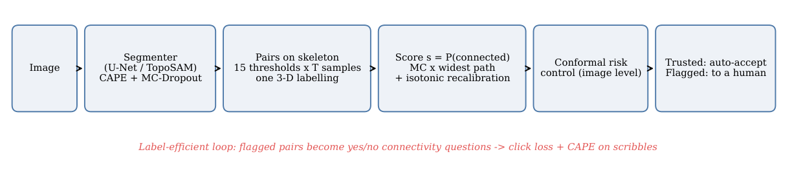
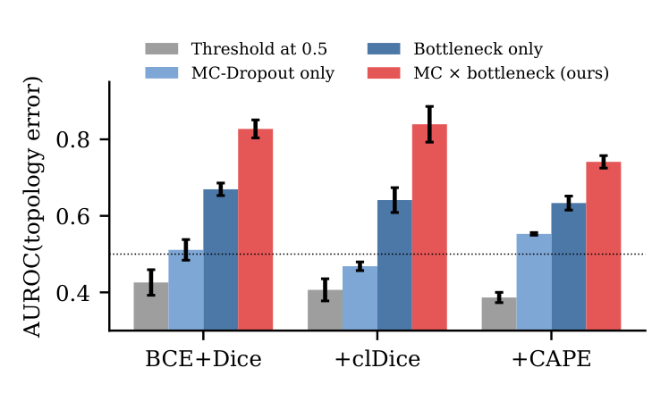
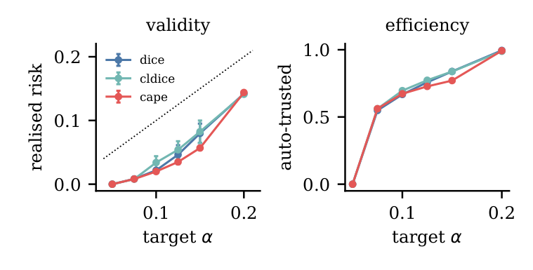
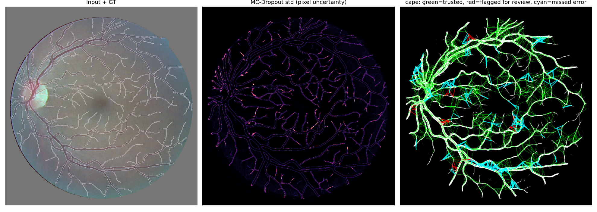

# Conformal Connectivity

**Calibrated, provable confidence for topology in curvilinear segmentation** — built on
[CAPE](https://github.com/NeuraVisionLab/CAPE) (Esmaeilzadeh, Garaaghaji, Hallaji Azad, Oner, MICCAI 2025).

Topology-aware losses such as clDice and CAPE make vessel, neuron and road segmentations *more connected*, but they
still output a single binary map: nothing says which connections can be trusted. This repository makes
**connectivity itself** the unit of uncertainty:

* a **connection score** for every pair of points — Monte-Carlo dropout × the widest-path (bottleneck) value of the
  probability map — computed for thousands of pairs, 15 thresholds and 20 samples with **one 3-D labelling per tile**;
* **guarantees**: class-conditional conformal sets and an **image-level conformal risk control** theorem
  (in expectation at most α of a new image's connections are wrongly auto-accepted), plus covariate-shift weighting;
* **label-efficient CAPE**: scribbles are partial graphs, yes/no *connectivity clicks* with a new click loss, and
  questions chosen by the score with spatial diversity;
* **TopoSAM**: Segment Anything (ViT-B, frozen encoder) trained with CAPE for few-shot road extraction;
* an **exact parallel CAPE** (identical loss to the official code, 7.5–14× faster).

📄 Paper draft: [`paper/main.pdf`](paper/main.pdf) · 🧪 Full experiment history: [`docs/EXPERIMENT_LOG.md`](docs/EXPERIMENT_LOG.md)



## Key results (3 seeds, mean; paired Wilcoxon over test images)

| Claim | Result |
|---|---|
| The score finds topology errors (DRIVE, BCE+Dice) | AUROC **0.83** vs 0.43 threshold · 0.51 MC-dropout · 0.67 bottleneck |
| Class-conditional conformal sets (target 0.90) | coverage **0.899 / 0.899**, only **12 %** of connections flagged |
| Image-level risk control on CAPE models (bound 0.10) | realised risk **0.024**, **69 %** auto-trusted, **72 %** of topology errors flagged |
| Calibration under distribution shift | coverage 0.82 → **0.98** with weighting |
| Label-efficient CAPE (6.7 % of pixels annotated) | **99 %** of dense-label clDice; uncertainty clicks: **12 %** fewer topology errors than random (p = 8.8·10⁻⁵) |
| TopoSAM vs a U-Net given the same clicks (roads) | clDice **+0.043** (p = 2.5·10⁻⁸), **0.28** fewer components per patch (p = 7.1·10⁻¹¹) |
| Independent re-evaluation of CAPE | path-level topology errors **−21 %** vs BCE+Dice (p = 1.9·10⁻⁶, 3/3 seeds) |

Negative results are reported too (zero-shot vessel→road transfer, label-free polarity selection, noisy annotators,
CRC infeasibility for very small α) — see §9 of the paper.

| Error detection by score | Risk control: validity and efficiency |
|---|---|
|  |  |


*DRIVE test image (CAPE model): green = auto-accepted correctly, red = flagged for review, cyan = auto-accepted wrongly.*

## Installation

```bash
git clone https://github.com/Youssef-Ahmed38/conformal-connectivity-cape.git
cd conformal-connectivity-cape
pip install -r requirements.txt        # install the PyTorch build for your CUDA first
python setup_data.py                   # DRIVE, Massachusetts Roads, official CAPE (pinned), SAM ViT-B  (~0.5 GB)
python tests/check_cape.py && python tests/check_uq.py && python tests/check_crc.py
```

`tests/check_cape.py` verifies that the parallel CAPE equals the official implementation on identical seeds.

## Quick start

```bash
bash scripts/run_all.sh 0                                   # phase 1: BCE+Dice, clDice, CAPE (seed 0)
python evaluate.py --runs dice cldice cape --out results/phase1      # scores, conformal sets, figures
python analyze_guarantees.py                                # image-level CRC + shift-weighted conformal
```

## Reproduce the paper

```bash
bash scripts/queue_master.sh       # all 43 runs (3 seeds), memory-aware GPU queue, then evaluation + aggregation
python eval_seeds.py --group drive && python eval_seeds.py --group roads   # resumable, cached in results/seeds/
python aggregate_seeds.py          # mean ± std over seeds + Wilcoxon tests -> results/final.md
python gen_paper_assets.py         # every table, number and figure of paper/ from the cached results
cd paper && tectonic main.tex      # or any LaTeX engine
```

Everything ran on one 8 GB laptop GPU (RTX 5060); the full study takes about half a day of GPU time. The queue scripts use
PowerShell for process checks (Windows); the Python code is platform-independent.

## Repository layout

```
ccape/                    library
  model.py                U-Net with Dropout2d (doubles as MC-dropout sampler)
  losses.py               BCE+Dice, soft clDice, CAPE wrapper
  paths.py, cape_fast.py  exact parallel CAPE (torch-free path search + GPU gather) and the connectivity-click loss
  topo_uq.py              pair sampling, connectivity of all maps in one 3-D labelling, connection scores
  conformal.py            Mondrian split conformal, isotonic (PAV) recalibration, ECE, AUROC
  crc.py                  image-level conformal risk control, covariate-shift-weighted conformal
  sparse.py               scribble simulation, uncertainty + diversity question selection, noisy annotator
  sam.py                  TopoSAM, cached-embedding domains, RandConv texture variants
  canon.py                scale-space (Hessian) polarity/scale estimation
  clickmap.py             click prompts as heat-map channels (fair U-Net baseline)
  data.py, infer.py, metrics.py
train.py                  phase 1 (dice | cldice | cape)
train_sparse.py           phase 2 label-efficient training (scribbles, clicks, size prior)
train_sam.py              phase 3 TopoSAM (dense or scribbles, polarity/texture augmentation)
evaluate.py, eval_phase3.py, eval_uq_roads.py, eval_seeds.py, aggregate_seeds.py, analyze_guarantees.py
zeroshot_probe.py, tta_select.py, fig_roads.py
gen_paper_assets.py, make_final_section.py
scripts/                  run_all.sh, queue_master.sh (+ jobs.ps1)
tests/                    exactness test vs official CAPE, connectivity, conformal and CRC checks
results/                  summary JSON/Markdown tables and figures (per-pair caches are regenerated)
paper/                    LaTeX source, generated tables/figures, compiled PDF
```

## Citation

```bibtex
@misc{mourad2026conformalconnectivity,
  title  = {Conformal Connectivity: Calibrated, Provable Confidence for Topology in Curvilinear Segmentation},
  author = {Mourad, Youssef},
  year   = {2026},
  note   = {Preprint. Code: https://github.com/Youssef-Ahmed38/conformal-connectivity-cape}
}
```
Please also cite CAPE (Esmaeilzadeh et al., MICCAI 2025), on which this work builds.

## License and acknowledgements

Code: [MIT](LICENSE). The official CAPE code (MIT, NeuraVision Lab), the SAM weights (Apache-2.0, Meta) and the DRIVE /
Massachusetts Roads datasets are downloaded by `setup_data.py` and remain under their own terms.
