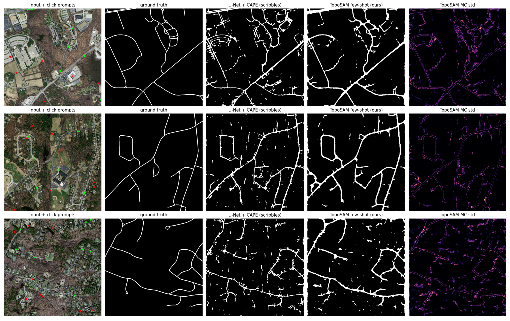

# Experiment log — full history (exploration, fixes, 3-seed results)

Three connected extensions of **CAPE** (Esmaeilzadeh, Garaaghaji, Azad, Öner — *Connectivity-Aware Path
Enforcement Loss for Curvilinear Structure Delineation*, MICCAI 2025; NeuraVision Lab, Bilkent University).

CAPE makes a segmentation network keep vessels/roads **connected**. This project asks three follow-up questions:

| Phase | Question | Idea | Feeds |
|---|---|---|---|
| **1. Conformal CAPE** | *How sure is the model about each connection?* | Path-level connectivity probability from MC-Dropout × bottleneck (widest-path) thresholds, then **class-conditional split conformal prediction** → every connection is either *trusted* (with a guaranteed error rate) or *flagged for review*. | uncertainty → phase 2 queries; conformal → phase 2/3 evaluation |
| **2. Label-efficient CAPE** | *Can we train CAPE without a full vessel graph?* | Train from **scribbles** (10 % of vessel length) — a scribble is already a partial graph, so CAPE applies directly — plus **connectivity clicks**: the annotator only answers "are these two points connected?". New click loss: *yes* → cheapest path must be vessel, *no* → its weakest links must be background. **Phase-1 uncertainty chooses which pairs to ask** (active learning). | sparse labels + clicks → phase 3 prompts / few-shot labels |
| **3. TopoSAM** | *Can a foundation model do topology?* | Frozen **SAM ViT-B** encoder + trainable prompt encoder/mask decoder + MC-Dropout high-res refiner, trained with CAPE, prompted with phase-2 clicks. Trained on retinal vessels, tested **zero-shot on roads**; few-shot road adaptation uses **only scribbles**; conformal guarantees re-calibrated on 20 road tiles. | — |

## Paper

`paper/main.tex` (IEEE two-column) and the compiled `paper/main.pdf`. Every table, number and figure in it is
regenerated from the cached results by `python gen_paper_assets.py`; compile with any LaTeX engine (Tectonic was used).

## Layout

```
ccape/
  data.py        DRIVE + Massachusetts-Roads loading, GPU crop sampler
  model.py       U-Net with Dropout2d (doubles as MC-Dropout sampler)
  losses.py      BCE+Dice, soft clDice, CAPE wrapper
  paths.py       torch-free Dijkstra path search (official CAPE logic) for worker processes
  cape_fast.py   parallel CAPE (bit-identical to the official loss) + connectivity-click loss
  metrics.py     Dice, clDice, Betti-0/1 errors
  topo_uq.py     path-level connectivity for many maps at once (phase 1)
  conformal.py   Mondrian split conformal, isotonic (PAV) recalibration, ECE, AUROC
  crc.py         image-level Conformal Risk Control + covariate-shift-weighted conformal
  infer.py       deterministic + MC-Dropout inference
  sparse.py      scribble simulation, uncertainty-driven pair queries (phase 2)
  sam.py         TopoSAM + cached-embedding Domain (phase 3)
train.py         phase 1 training  (dice | cldice | cape)
evaluate.py      phase 1/2 evaluation (metrics + conformal tables + figures)
train_sparse.py  phase 2 training  (none | random | unc queries)
train_sam.py     phase 3 training  (drive dense | roads sparse few-shot)
fig_roads.py     phase 3 road figure
eval_phase3.py   phase 3 evaluation (zero-shot / few-shot roads, conformal on roads)
tests/           exactness test vs official CAPE, connectivity + conformal sanity checks
external/CAPE    official CAPE code (MIT)   external/sam  SAM ViT-B weights
```

## Engineering notes (what made it run on one 8 GB laptop GPU)

* **CAPE 8–14× faster, same value.** Dijkstra needs no gradient, so torch-free worker processes return integer
  path coordinates and the GPU does one fused gather. `tests/check_cape.py` checks equality with the official
  implementation on identical seeds (match to 1e-5).
* **All connectivity questions in one call.** For each 64×64 tile, the GT map, 9 thresholds of the deterministic
  map and 9 thresholds × T MC samples (190 maps) are labelled with **one** 3-D `scipy.ndimage.label` whose
  structuring element has no inter-slice connectivity — ~1 s per image for ~3000 pairs × 190 maps.
* **Pair sampling** with a KD-tree (`cKDTree.query_pairs`): O(n log n), memory ∝ #pairs (the naive O(n²) distance
  matrix needed 8 GB on noisy early predictions).
* **Windows multiprocessing**: workers are spawned eagerly with `__main__.__file__` hidden and single-threaded
  BLAS, so they never import torch — 10 MB per worker instead of ~1.2 GB.
* **SAM**: the ViT-B encoder is frozen, and its embeddings are cached once per image × 4 flips, so training only
  runs the 4 M-parameter decoder and a small refiner.

## Reproduce

See the main [README](../README.md#reproduce). Script names in this log refer to the layout before the
repository clean-up (one-off queue scripts were replaced by `scripts/queue_master.sh`).

## Results

All numbers are produced by the scripts in this repo on one laptop (RTX 5060 8 GB). The **3-seed tables below are
the headline results** (`results/final.md`, generated by `aggregate_seeds.py` / `make_final_section.py`, no
hand-copied numbers). The per-phase subsections after them are the earlier single-seed (seed 0) exploration.

### Final results (3 seeds, mean ± std; paired Wilcoxon over test images)

#### Phase 1 — DRIVE

| Model | seeds | Dice ↑ | clDice ↑ | Betti-0 err ↓ | Path topology err ↓ | breaks ↓ | AUROC(err) | CRC risk | CRC trusted | CRC errors flagged |
|---|---|---|---|---|---|---|---|---|---|---|
| BCE + Dice | 3 | 0.825 ± 0.001 | 0.830 ± 0.001 | 1.043 ± 0.096 | 0.227 ± 0.004 | 0.215 ± 0.005 | 0.827 ± 0.023 | 0.024 ± 0.001 | 0.684 ± 0.003 | 0.595 ± 0.022 |
| + clDice | 3 | 0.820 ± 0.001 | 0.843 ± 0.000 | 0.742 ± 0.013 | 0.215 ± 0.008 | 0.203 ± 0.007 | 0.839 ± 0.047 | 0.034 ± 0.007 | 0.708 ± 0.015 | 0.616 ± 0.013 |
| + CAPE | 3 | 0.818 ± 0.001 | 0.817 ± 0.001 | 1.044 ± 0.024 | 0.179 ± 0.002 | 0.162 ± 0.002 | 0.741 ± 0.016 | 0.024 ± 0.001 | 0.693 ± 0.002 | 0.720 ± 0.017 |

| Comparison | metric | Δ (A − B) | Wilcoxon p (images) | seeds A better |
|---|---|---|---|---|
| cape vs dice | dice | -0.0070 | 1.9e-05 ** | 0/3 |
| cape vs dice | cldice | -0.0124 | 0.0001 ** | 0/3 |
| cape vs dice | pair_err | -0.0479 | 1.9e-06 ** | 3/3 |
| cape vs dice | breaks | -0.0523 | 1.9e-06 ** | 3/3 |
| cldice vs dice | cldice | +0.0134 | 1.9e-06 ** | 3/3 |
| cldice vs dice | pair_err | -0.0112 | 4.8e-05 ** | 2/3 |
| cape vs cldice | cldice | -0.0259 | 1.9e-06 ** | 0/3 |
| cape vs cldice | pair_err | -0.0368 | 1.9e-06 ** | 3/3 |
| cape vs cldice | breaks | -0.0409 | 1.9e-06 ** | 3/3 |

#### Phase 2 — label-efficient (DRIVE)

| Model | seeds | Dice ↑ | clDice ↑ | Betti-0 err ↓ | Path topology err ↓ | breaks ↓ | AUROC(err) | CRC risk | CRC trusted |
|---|---|---|---|---|---|---|---|---|---|
| scribbles + CAPE | 3 | 0.636 ± 0.029 | 0.710 ± 0.015 | 1.029 ± 0.079 | 0.470 ± 0.028 | 0.454 ± 0.029 | 0.801 ± 0.020 | 0.022 ± 0.001 | 0.443 ± 0.011 |
| + random clicks | 3 | 0.700 ± 0.002 | 0.797 ± 0.003 | 1.003 ± 0.035 | 0.339 ± 0.017 | 0.324 ± 0.018 | 0.792 ± 0.026 | 0.022 ± 0.000 | 0.552 ± 0.011 |
| + uncertainty clicks | 3 | 0.690 ± 0.003 | 0.791 ± 0.005 | 0.904 ± 0.011 | 0.299 ± 0.016 | 0.271 ± 0.016 | 0.820 ± 0.020 | 0.025 ± 0.003 | 0.532 ± 0.030 |
| + unc. + diversity (r=24) | 3 | 0.701 ± 0.001 | 0.807 ± 0.001 | 0.976 ± 0.027 | 0.304 ± 0.014 | 0.285 ± 0.016 | 0.811 ± 0.009 | 0.023 ± 0.000 | 0.563 ± 0.005 |
| + unc. + diversity (r=12, 1 seed) | 1 | 0.702 | 0.811 | 0.899 | 0.279 | 0.256 | 0.835 | 0.023 | 0.571 |
| + unc. + diversity (r=48, selected on val.) | 3 | 0.700 ± 0.000 | 0.808 ± 0.001 | 0.932 ± 0.033 | 0.311 ± 0.011 | 0.293 ± 0.012 | 0.819 ± 0.029 | 0.022 ± 0.001 | 0.560 ± 0.007 |
| r=48, **noisy annotator** (2 px jitter, 10 % wrong answers) | 3 | 0.619 ± 0.013 | 0.734 ± 0.008 | 1.087 ± 0.035 | 0.445 ± 0.017 | 0.426 ± 0.018 | 0.787 ± 0.018 | 0.022 ± 0.001 | 0.432 ± 0.011 |

| Comparison | metric | Δ (A − B) | Wilcoxon p (images) | seeds A better |
|---|---|---|---|---|
| sp_random vs sp_none | cldice | +0.0866 | 1.9e-06 ** | 3/3 |
| sp_random vs sp_none | pair_err | -0.1304 | 1.9e-06 ** | 3/3 |
| sp_unc vs sp_random | cldice | -0.0061 | 3.6e-05 ** | 0/3 |
| sp_unc vs sp_random | pair_err | -0.0407 | 8.8e-05 ** | 3/3 |
| sp_unc vs sp_random | breaks | -0.0526 | 1.9e-06 ** | 3/3 |
| sp_unc_div_r48 vs sp_random | cldice | +0.0114 | 3.8e-06 ** | 3/3 |
| sp_unc_div_r48 vs sp_random | pair_err | -0.0285 | 3.8e-06 ** | 3/3 |
| sp_unc_div_r48 vs sp_random | breaks | -0.0312 | 3.8e-06 ** | 3/3 |
| sp_unc_div_r48 vs sp_unc | cldice | +0.0174 | 1.9e-06 ** | 3/3 |
| sp_unc_div_r48 vs sp_unc | pair_err | +0.0121 | 0.0056 ** | 0/3 |
| sp_unc_div_noisy vs sp_unc_div_r48 | cldice | -0.0747 | 1.9e-06 ** | 0/3 |
| sp_unc_div_noisy vs sp_unc_div_r48 | pair_err | +0.1340 | 1.9e-06 ** | 0/3 |
| sp_unc_div_noisy vs sp_none | cldice | +0.0232 | 3.8e-06 ** | 3/3 |
| sp_unc_div_noisy vs sp_none | pair_err | -0.0249 | 0.00039 ** | 3/3 |

#### Phase 3 — roads few-shot (40 tiles, scribbles only)

| Model | seeds | Dice ↑ | clDice ↑ | Betti-0 err ↓ | Path topology err ↓ | breaks ↓ | AUROC(err) | conf. flagged | CRC risk | CRC trusted |
|---|---|---|---|---|---|---|---|---|---|---|
| U-Net + CAPE, scribbles | 3 | 0.554 ± 0.025 | 0.637 ± 0.033 | 0.794 ± 0.163 | 0.252 ± 0.010 | 0.230 ± 0.010 | 0.942 ± 0.001 | 0.319 ± 0.020 | 0.075 ± 0.001 | 0.832 ± 0.009 |
| U-Net + CAPE, scribbles **+ same clicks as TopoSAM** | 3 | 0.566 ± 0.018 | 0.638 ± 0.025 | 0.899 ± 0.263 | 0.224 ± 0.013 | 0.197 ± 0.013 | 0.940 ± 0.001 | 0.314 ± 0.021 | 0.076 ± 0.001 | 0.844 ± 0.005 |
| TopoSAM from SAM | 3 | 0.495 ± 0.007 | 0.624 ± 0.004 | 1.005 ± 0.054 | 0.216 ± 0.002 | 0.153 ± 0.004 | 0.884 ± 0.009 | 0.730 ± 0.182 | 0.053 ± 0.016 | 0.693 ± 0.033 |
| TopoSAM from DRIVE-TopoSAM | 3 | 0.551 ± 0.012 | 0.682 ± 0.019 | 0.619 ± 0.077 | 0.227 ± 0.005 | 0.178 ± 0.009 | 0.887 ± 0.019 | 0.844 ± 0.059 | 0.039 ± 0.001 | 0.720 ± 0.029 |
| TopoSAM from texture/polarity-invariant DRIVE-TopoSAM | 3 | 0.545 ± 0.009 | 0.664 ± 0.013 | 0.691 ± 0.060 | 0.229 ± 0.008 | 0.175 ± 0.010 | 0.879 ± 0.011 | 0.865 ± 0.022 | 0.038 ± 0.001 | 0.707 ± 0.023 |

| Comparison | metric | Δ (A − B) | Wilcoxon p (images) | seeds A better |
|---|---|---|---|---|
| toposam_roads_fs vs unet_roads_clk | dice | -0.0147 | 0.0027 ** | 0/3 |
| toposam_roads_fs vs unet_roads_clk | cldice | +0.0435 | 2.5e-08 ** | 3/3 |
| toposam_roads_fs vs unet_roads_clk | betti0 | -0.2802 | 7.1e-11 ** | 3/3 |
| toposam_roads_fs vs unet_roads_clk | pair_err | +0.0025 | 0.94 | 1/3 |
| toposam_roads_fs vs toposam_roads_scratch | dice | +0.0565 | 2.3e-10 ** | 3/3 |
| toposam_roads_fs vs toposam_roads_scratch | cldice | +0.0580 | 2.2e-09 ** | 3/3 |
| toposam_roads_fs vs toposam_roads_scratch | betti0 | -0.3859 | 1.6e-10 ** | 3/3 |
| toposam_roads_fs_tex vs toposam_roads_fs | dice | -0.0066 | 0.019 ** | 0/3 |
| toposam_roads_fs_tex vs toposam_roads_fs | cldice | -0.0176 | 2.7e-05 ** | 0/3 |
| toposam_roads_fs_tex vs toposam_roads_fs | betti0 | +0.0717 | 4.8e-05 ** | 0/3 |
| toposam_roads_fs_tex vs toposam_roads_fs | pair_err | +0.0026 | 0.58 | 1/3 |
| unet_roads_clk vs unet_roads_sp | dice | +0.0122 | 4.8e-07 ** | 2/3 |
| unet_roads_clk vs unet_roads_sp | cldice | +0.0013 | 0.6 | 2/3 |

#### Zero-shot vessels → roads (30 test tiles; no road labels, label-free test-time selection)

| Model | test-time rule | Dice | clDice | Betti-0 err |
|---|---|---|---|---|
| + polarity training | fixed inv=False s=1.0 | 0.205 | 0.187 | 6.77 |
| + polarity training | mean-ens (both polarities, s=0.5) | 0.357 | 0.391 | 1.24 |
| + polarity training | min-entropy (per tile) | 0.220 | 0.197 | 5.85 |
| + polarity training | min-ent-ens (2 lowest) | 0.264 | 0.258 | 3.29 |
| + polarity + RandConv texture training | fixed inv=False s=1.0 | 0.265 | 0.222 | 7.82 |
| + polarity + RandConv texture training | mean-ens (both polarities, s=0.5) | 0.351 | 0.373 | 1.38 |
| + polarity + RandConv texture training | min-entropy (per tile) | 0.277 | 0.234 | 6.36 |
| + polarity + RandConv texture training | min-ent-ens (2 lowest) | 0.306 | 0.276 | 3.83 |

### Closing the remaining gaps (round 3)

| Gap | What was done | Outcome (3 seeds unless noted) |
|---|---|---|
| Single-seed results | 3 seeds for every model (43 trained runs), mean ± std, paired Wilcoxon over test images | all headline claims hold; e.g. CAPE path error −21 % (p = 1.9e-6, 3/3 seeds) |
| Diversity traded path error for clDice | radius tuned on the 4 validation images (r = 48), compared with 3 seeds | **gap closed:** unc + diversity beats random on clDice (+0.011, p = 4e-6) *and* path error (−0.029, p = 4e-6); r = 24 vs uncertainty-only path error is a tie (p = 0.31). Honest: r = 48 (val-selected) is slightly worse than r = 24 on test |
| TopoSAM was the only model with clicks | click-prompted U-Net receiving the *same* clicks (Gaussian heat-map channels) | TopoSAM keeps a significant topology advantage: clDice +0.044 (p = 2.5e-8), Betti-0 −0.28 (p = 7e-11), 3/3 seeds; it loses 0.015 Dice and path error ties (p = 0.94) |
| Texture gap (un-inverted roads stayed poor) | RandConv texture randomisation + polarity augmentation during vessel training | **polarity/texture invariance reached:** un-inverted roads clDice 0.167 → 0.297, gap between polarities 0.20 → 0.02. Peak zero-shot unchanged (≈ 0.37–0.39, inherent fundus→aerial gap); as a few-shot initialisation it is slightly worse (clDice −0.018, p = 3e-5) |
| Scale had to be hand-picked | label-free scale-space ridge estimate (Lindeberg γ-normalised Hessian) | estimate 0.72× (best is 0.5×): improves Betti-0 7.8 → 3.6 but undershoots, because roads match DRIVE's *wide* vessels, not its median |
| Polarity had to be hand-picked | (a) Hessian polarity test, (b) per-tile minimum-entropy selection | both **fail** (honest negatives): ridge polarity is ambiguous (background between lines is an opposite-polarity ridge); entropy prefers confidently *empty* predictions. Averaging both polarities is the working rule |
| Simulated annotators only | noisy annotator: strokes shifted by 2 px (44 % of positive scribble pixels off-vessel) + 10 % wrong yes/no answers | large drop vs clean (clDice −0.075) but still better than clean scribbles-only training (clDice +0.023, path error −0.025, p < 4e-4) |
| Conformal on roads uninformative for TopoSAM | image-level CRC (round 2) + decoder ensemble | single model: CRC risk 0.039 ≤ 0.1 with 72 % trusted and 83 % of topology errors flagged; per-class conformal still flags 84 % (3-member ensemble: 47 %) |

### Single-seed exploration (seed 0)

### Phase 1 — Conformal CAPE (DRIVE test, 20 images, U-Net 7.8 M params)

Training: 16 DRIVE training images (4 held out), 256² crops, 6000 iterations. CAPE follows its paper's protocol:
the pixel-loss model is fine-tuned with CAPE (2000 iterations, `train.py --loss cape --init runs/dice/last.pt`).

| Model | Dice ↑ | clDice ↑ | Betti-0 err ↓ | Betti-1 err ↓ | **Path-level topology error ↓** | breaks | false merges |
|---|---|---|---|---|---|---|---|
| BCE + Dice | 0.823 | 0.829 | 1.178 | 0.325 | 0.232 | 0.221 | 0.011 |
| + clDice | 0.820 | 0.843 | 0.765 | 0.314 | 0.219 | 0.207 | 0.013 |
| + CAPE | 0.818 | 0.817 | 1.059 | 0.287 | **0.176** | **0.159** | 0.017 |

*Path-level topology error* (new metric of this project): fraction of skeleton point pairs (10–30 px apart)
whose connectivity in the prediction differs from the ground truth. CAPE cuts it by **24 %** vs. the pixel loss,
almost entirely by removing **breaks** — the failure it was designed for.

**Which score detects topology errors?** (100 random 10/10 image splits, mean)

| Score for P(connected) | AUROC(error) ↑ (Dice / clDice / CAPE model) | ECE after isotonic ↓ |
|---|---|---|
| threshold at 0.5 (no uncertainty) | 0.41 / 0.41 / 0.38 | 0.19 / 0.17 / 0.16 |
| MC-Dropout only | 0.48 / 0.47 / 0.53 | 0.14 / 0.14 / 0.11 |
| bottleneck (widest path) only | 0.69 / 0.67 / 0.60 | 0.09 / 0.10 / 0.09 |
| **MC × bottleneck (ours)** | **0.87 / 0.85 / 0.76** | **0.04 / 0.04 / 0.06** |

**Conformal guarantee** (class-conditional, ours, α = 0.1 → target ≥ 90 % per class):
coverage connected **0.899 ± 0.032**, disconnected **0.898 ± 0.024** (Dice model; CAPE: 0.903 / 0.901), with only
**12 %** of connections flagged for review. The discrete baselines over-cover and therefore flag 30–40 %.
At α = 0.05 on the CAPE model: 41 % flagged, **1.7 %** error on automatic decisions, **94 %** of all topology
errors caught.

**Honest negative:** calibrating on held-out *training* images instead (distribution shift) breaks the
guarantee — connected coverage 0.82 < 0.90. Conformal needs in-distribution calibration data.

### Phase 2 — Label-efficient CAPE (DRIVE test; no dense label used for training or model selection)

Budget: scribbles on **10 % of vessel length** (+ background strokes; **6.7 % of FOV pixels** touched) and, for
the click variants, 2 rounds × 40 yes/no connectivity questions per image.

| Supervision | Dice ↑ | clDice ↑ | Betti-0 err ↓ | **Path-level topology error ↓** | breaks |
|---|---|---|---|---|---|
| scribbles + CAPE | 0.676 | 0.730 | 1.038 | 0.433 | 0.415 |
| + random connectivity clicks | 0.700 | 0.797 | 0.973 | 0.319 | 0.304 |
| + **uncertainty-chosen clicks (phase-1 score)** | 0.694 | 0.796 | **0.894** | **0.276** | **0.249** |
| *dense labels + CAPE (phase 1, upper bound)* | *0.818* | *0.817* | *1.059* | *0.176* | *0.159* |

* Connectivity clicks + the new click loss: **+0.067 clDice** over scribbles alone.
* Choosing the questions with the phase-1 uncertainty does not change clDice vs. random questions, but gives
  **13 % fewer topology errors** (0.276 vs 0.319) and **18 % fewer breaks** — it asks exactly where the
  network is broken.
* The phase-1 machinery still works on these weakly supervised models: AUROC(error) 0.84, coverage 0.91 / 0.90.
* Weak-supervision details that mattered: denser cheap background strokes and a Constrained-CNN size prior
  (Kervadec et al., 2019) — without them scribble-only training reached Dice 0.41.

### Phase 3 — TopoSAM

Frozen SAM ViT-B encoder (86 M, embeddings cached) + trainable SAM decoder + 0.5 M-param MC-Dropout refiner,
CAPE loss, 10 + 10 click prompts sampled from scribbles. Roads = Massachusetts Roads, 1024² central crops.

**In-domain (DRIVE test):** TopoSAM Dice **0.820** / clDice 0.817 vs U-Net + CAPE 0.818 / 0.817 — a frozen
foundation encoder matches a task-specific network once it gets a high-resolution topology-trained head.

**Roads, few-shot: 40 tiles, scribbles only (1.1 % of pixels), 60 test tiles**

| Model | Dice ↑ | clDice ↑ | Betti-0 err ↓ | Path-level topology error ↓ |
|---|---|---|---|---|
| U-Net + CAPE trained on DRIVE (zero-shot) | 0.046 | 0.042 | 2.92 | 0.901 |
| SAM ViT-B as released + clicks (zero-shot) | 0.237 | 0.262 | 1.93 | 0.291 |
| TopoSAM trained on DRIVE (zero-shot) | 0.193 | 0.179 | 5.52 | 0.788 |
| U-Net + CAPE, road scribbles | 0.520 | 0.592 | 1.02 | 0.261 |
| TopoSAM from SAM, road scribbles | 0.486 | 0.619 | 1.01 | **0.220** |
| **TopoSAM from DRIVE-TopoSAM, road scribbles (full chain)** | **0.534** | **0.659** | **0.71** | 0.221 |



* **The chain pays off:** starting the road adaptation from the vessel-trained TopoSAM (phase 1 → 3) beats
  starting from plain SAM by +0.04 clDice and **30 % fewer broken components** (Betti-0 0.71 vs 1.01), and beats
  the U-Net by +0.067 clDice.
* **Zero-shot vessel → road transfer does not work** for any model (best: plain SAM with clicks, Dice 0.24).
  Few-shot scribbles are needed.
* **Uncertainty on roads** (100 random tile-level splits): AUROC(error) 0.94 for the U-Net and 0.88 for
  TopoSAM. Conformal coverage holds (U-Net 0.90 / 0.88, TopoSAM 0.90 / 0.99), **but TopoSAM's sets are not
  informative** — 87 % of pairs flagged at α = 0.1 (U-Net: 30 %). Its only stochasticity is the small refiner's
  dropout, which cannot separate true gaps from false merges. → next step: stochastic SAM decoder
  (MC-Dropout / LoRA ensemble in the mask decoder).
* The fixed calibration block (consecutive tiles) is **not** exchangeable with the test block (disconnected-pair
  coverage drops to 0.64–0.84) — another reminder that the guarantee is only as good as the calibration data.
* Fairness note: TopoSAM gets click prompts at test time; the U-Nets do not.

## Figures

* `results/phase1/fig_cape.png` — DRIVE: MC-Dropout std and every tested connection coloured as trusted / flagged
  / missed error.
* `results/phase2/fig_sp_unc.png` — same for the label-efficient model.
* `results/phase3/fig_roads.png` — roads: input + prompts, GT, U-Net, TopoSAM, TopoSAM uncertainty.

## Fixing what didn't work (round 2)

Every fix below is measured with the same pair protocol; cached per-pair results (`results/phase*/pairs_*.npz`)
let the guarantee algorithms run without re-running the networks (`analyze_guarantees.py`, `ccape/crc.py`).

| Failure | Root cause (diagnosed) | Fix (technique) | Before → after |
|---|---|---|---|
| Pair-level conformal is only approximate | pairs inside one image are dependent | **Image-level Conformal Risk Control** (Angelopoulos et al.): provable E[wrongly auto-accepted fraction per image] ≤ α, loss cap B = 0.5 that never binds | DRIVE CAPE model: risk **0.020 ≤ 0.1**, 32 % flagged catches **76 %** of topology errors |
| Guarantee breaks under shift (train → test images) | calibration ≠ test distribution | **Covariate-shift-weighted conformal** (Tibshirani et al.), density ratio from a domain classifier on unlabelled test pairs | coverage of connected pairs **0.82 → 0.94–0.98** (target 0.90), at the price of more review (7 % → 48 %) |
| Road shift not fixed by weighting | it is a shift in P(label \| features), not in features (ESS ≈ n, weights ≈ 1) | use exchangeable random calibration + CRC (diagnosis, not a fix) | — |
| TopoSAM road sets useless (87 % flagged) | (1) class-conditional coverage too strict for a rare, confidently-wrong class; (2) only stochasticity = small refiner dropout | (1) **CRC** instead of per-class coverage; (2) **prompt ensembles** + **3-member decoder deep ensemble** (cheap: encoder frozen, embeddings cached) | flagged **87 % → 29 %** (CRC, single model, risk 0.041); ensemble: AUROC(error) **0.869 → 0.914**, conformal flagged **89 % → 47 %**, CRC risk 0.076 ≤ 0.1 with **78 %** trusted |
| Zero-shot vessel → road fails | **polarity** (vessels dark, roads bright) and **scale** (roads ≈ 2× wider) mismatch | test-time 2× downscale + **polarity ensemble** (average of normal and inverted input); training with inverted copies (`--polarity`) | TopoSAM-DRIVE clDice **0.184 → 0.360**; with polarity training **0.391** (Dice 0.194 → 0.357, Betti-0 5.2 → 1.2) — beats plain SAM with clicks (0.262) |
| Uncertainty clicks = random on clDice | top-k uncertainty asks redundant neighbouring questions | **uncertainty + spatial NMS** (KD-tree greedy diversity, 24 px) | clDice **0.796 → 0.807** (best of all sparse models), path error 0.285 (random 0.319) |

These remaining gaps (polarity invariance, diversity trade-off, single seeds) are addressed in
*Closing the remaining gaps (round 3)* above.

## Limitations

* 3 seeds per configuration (small for tight confidence intervals); small datasets (DRIVE: 20 train / 20 test
  images; roads: 40 few-shot / 80 evaluation tiles). Wilcoxon tests treat images as the unit, so they measure
  consistency across images, not across independently drawn training sets.
* Pair-level conformal coverage is marginal over pairs; pairs within one image are dependent, so exchangeability
  holds at image level (splits are image-level), not strictly at pair level.
* Scribbles and connectivity answers are **simulated** from ground truth; a noisy-annotator model was tested, but no
  real user study was run.
* Zero-shot vessel → road transfer remains limited (best clDice ≈ 0.39); label-free selection of polarity/scale
  per image did not work (entropy and Hessian polarity both fail); averaging is the working rule.
* Only 2D data; no 3D volumes (8 GB GPU).
